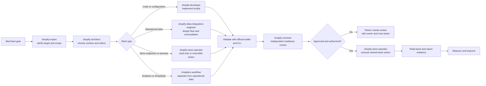

# Shopify Agent Workflow

Use this workflow for requests that span more than one Shopify role. It keeps
the agent's responsibility, lifecycle state, and approval boundary visible.

## How to apply it

1. Start at `proposed` with a named project/store target and desired outcome.
2. Let the architect choose the smallest appropriate Shopify surface.
3. Run independent discovery or review work in parallel only when it cannot
   mutate shared state.
4. Keep implementation, approval, publishing, and live mutations sequential.
5. Move to the next lifecycle state only with the evidence described in
   [lifecycle.md](../methodology/lifecycle.md).
6. Use the [handoff record](../methodology/handoff-record.md) at every role
   transition.

## Safety boundary

The diagram shows possible routing, not automatic permission. A preview is not
a publication, a deployment is not proof of live state, and a successful
command is not proof that the intended resource changed.
